# Benchmarking FlashAttention against standard multi-head self-attention

**An inference optimisation case study for a Transformer attention layer — with every
number measured, not quoted.**

Hardware: NVIDIA GeForce RTX 5070 (Blackwell, sm_120, 12 GB, 48 SMs) ·
PyTorch 2.11.0+cu128 · CUDA 12.8 · cuDNN 91900 · Triton 3.6.0 · driver 595.71.05.

Measured device ceilings used throughout as reference points:
**67.2 TFLOP/s** dense fp16 matmul, **561 GB/s** HBM copy bandwidth.

---

## 1. Objective and scope

The layer under study is **multi-head self-attention (MHA)**, the core block of every
modern Transformer. The optimisation studied is **FlashAttention** — an exact
re-formulation of attention that changes *how* the computation is scheduled on the
GPU, not *what* it computes.

The brief asks for five things. All five were implemented and run end to end:

1. **Implement the original layer.** `naive_attention` in [attention.py](src/attention.py)
   writes the formula literally, materialising the N×N score matrix `S` and probability
   matrix `P` in GPU memory. A complete `MultiHeadSelfAttention` module wraps it with
   Q/K/V/O projections.
2. **Implement the optimised variant.** Three of them, at increasing levels of realism:
   the FlashAttention *algorithm* written from scratch in pure PyTorch
   (`flash_attention_tiled`), a hand-written **FlashAttention-2 style fused kernel in
   Triton** ([flash_triton.py](src/flash_triton.py)), and the production
   `flash-attn`/cuDNN kernels reached through PyTorch's SDPA dispatcher.
3. **Pass identical inputs through both and measure.** Latency, peak memory and output
   difference across nine sweeps — sequence length, long context, causal masking, head
   dimension, batch size, dtype, full layer, training step, and autoregressive decode.
4. **Explain the mechanism.** §3, with a roofline experiment (§3.4) and a control
   experiment (§3.5) that isolates *which part* of FlashAttention supplies the speed-up.
5. **Extend to other methods and choose between them.** §7–§8 measure xFormers-style
   memory-efficient attention, cuDNN attention, SDPA auto-dispatch, MQA and GQA, and
   derive a decision procedure from the measurements.

Three things were added because the brief's questions cannot be answered honestly
without them: a **49-check correctness suite** (§4.1) run before any timing was trusted;
a **seed-variance study** (§7.4) testing whether the observed MQA/GQA quality
differences are real or noise; and `tests/verify_report.py`, which re-derives **all 84
quantitative claims in this document** from the raw JSON so no number here can drift
from the measurement it came from.

> **A note on the source document.** The results table in
> `FlashAttention_Benchmark_Report.docx` is explicitly labelled as *representative
> figures* for an A100/H100-class card, with the instruction that they "should be
> re-measured on the target hardware rather than assumed". This report is that
> re-measurement. Two of its three qualitative predictions hold, one does not, and its
> absolute figures are off by one to two orders of magnitude — §5.1 compares them
> line by line.

---

## 2. Background: standard multi-head self-attention

Scaled dot-product attention, for Q, K, V of shape (N, d):

$$\text{Attention}(Q,K,V) = \text{softmax}\!\left(\frac{QK^\top}{\sqrt d}\right)V$$

Multi-head attention runs `h` of these in parallel on d/h-dimensional subspaces and
concatenates. Taken literally, the formula requires two N×N tensors to exist in GPU
memory at once:

```python
s = (q @ k.transpose(-2, -1)) * scale   # (B, H, N, N)  <- written to HBM
p = torch.softmax(s, dim=-1)            # (B, H, N, N)  <- written to HBM
out = p @ v                             # (B, H, N, D)
```

- **Compute:** O(N²·d) FLOPs, dominated by the two matmuls.
- **Memory:** O(N²) *extra* activation memory for `S` and `P`, on top of O(N·d) for the
  inputs and output.

The quadratic memory term is the practical bottleneck. Measured at batch 16, 12 heads,
d=64, fp16, the attention op alone allocates **3,272 MB at N=2048** and runs out of
memory on a 12 GB card at N=4096 — before any model weights, gradients or optimiser
state are accounted for.

---

## 3. The optimisation: FlashAttention

> Tri Dao, Daniel Y. Fu, Stefano Ermon, Atri Rudra, Christopher Ré.
> *FlashAttention: Fast and Memory-Efficient Exact Attention with IO-Awareness.*
> NeurIPS 2022.

### 3.1 The problem: attention is memory-bound, not compute-bound

A GPU's on-chip SRAM has far higher bandwidth than off-chip HBM, but only a few
megabytes per SM. The naive kernel writes `S` to HBM, reads it back for the softmax,
writes `P`, and reads it back for the second matmul. Even though the arithmetic is
O(N²·d), wall-clock time is dominated by those round-trips.

**This is measurable, and it was measured.** At N=2048 the naive kernel achieves
**10.4 TFLOP/s — 15.5% of this card's 67.2 TFLOP/s matmul peak.** It is not short of
arithmetic capability; it is starved of bandwidth.

### 3.2 The mechanism: tiling plus an online softmax

FlashAttention never forms the full N×N matrix. Q is split into row blocks, K and V
into column blocks. For each query block it keeps a running row-max `m`, a running
softmax denominator `l`, and a running output accumulator `O`, rescaling all three
whenever a new block shifts the max:

```
for each query block Q_i:                      # stays resident in SRAM
    m ← -inf ;  l ← 0 ;  O ← 0
    for each key/value block K_j, V_j:
        S_ij  ← Q_i K_jᵀ / √d                  # small tile, SRAM only
        m_new ← max(m, rowmax(S_ij))
        α     ← exp(m - m_new)                 # correction for what we already have
        P_ij  ← exp(S_ij - m_new)
        l     ← α·l + rowsum(P_ij)
        O     ← α·O + P_ij V_j
        m     ← m_new
    write O / l to HBM                         # the only large write-back
```

The rescaling by `α` is the whole trick: every partial sum accumulated so far is
corrected by exactly the factor the final normaliser would have applied, so after the
last block `O/l` equals the textbook result. **This is an identity, not an
approximation.** [test_correctness.py](tests/test_correctness.py) verifies it in
float64: the from-scratch tiled implementation matches the textbook formula to
**≤ 1.1e-15 max absolute error**, and the result is invariant to tile size across
`(16,16)`, `(32,128)`, `(128,32)`, `(384,384)` and the deliberately awkward `(100,77)`.

### 3.3 Why this makes it faster

Total FLOPs are unchanged. What changes is HBM traffic:

- **Standard kernel:** write S, read S, write P, read P — several full O(N²) round-trips.
- **FlashAttention:** load Q/K/V tiles, do everything in SRAM, write O once. HBM
  accesses drop from O(N²) to O(N²/M) for SRAM size M, which the paper proves is
  asymptotically optimal.

### 3.4 Evidence: a roofline experiment

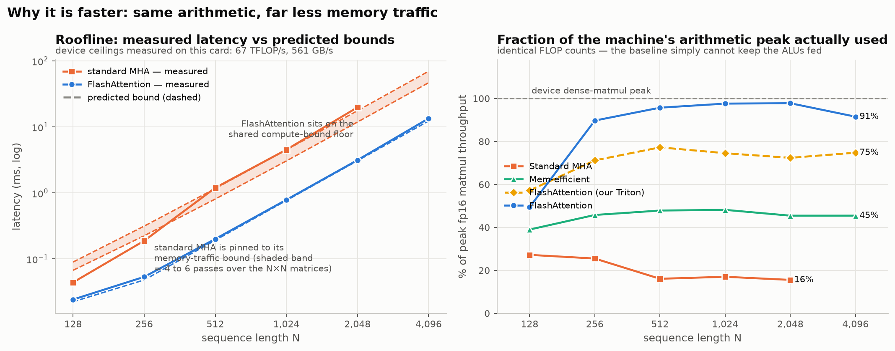

Both kernels execute identical FLOP counts, so the compute-bound floor is shared; only
the memory-bound ceiling differs. Using the card's measured ceilings (67.2 TFLOP/s,
561 GB/s), the prediction is that the baseline should sit on its memory-traffic bound
and the fused kernel on the compute floor. That is exactly what is observed — the
standard MHA measurements land inside the shaded 4-to-6-pass traffic band, while
FlashAttention tracks the compute line.

The right panel states it most directly — **fraction of the machine's arithmetic peak
actually used**:

| Kernel | % of peak fp16 matmul throughput (N=2048 / N=4096) |
|---|---:|
| Standard MHA (explicit N×N) | 15.5% / *OOM* |
| Memory-efficient (xFormers-style) | 45.4% / 45.4% |
| FlashAttention (our Triton kernel) | 72.3% / 74.7% |
| cuDNN fused attention | 89.1% / 91.4% |
| FlashAttention (SDPA flash) | **97.8%** / 91.5% |

In absolute terms:

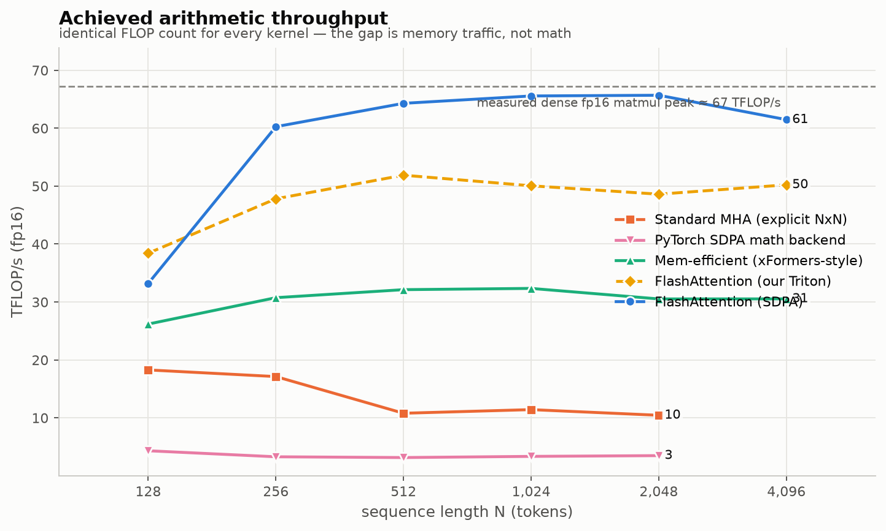

The optimisation converts a memory-bandwidth-bound kernel into a compute-bound one that
runs at **97.8% of what the silicon can do on a plain matmul** at N=2048 (and ~91% at
N=4096, where per-tile tail effects cost a little). There is very little headroom left
to recover — which is also why the speed-up stops growing (§5.1).

### 3.5 Control experiment: is it the algorithm or the fusion?

A question the brief invites but which is easy to answer wrongly. The tiled online-softmax
*algorithm* and the fused *kernel* are separable, and we can measure them separately by
running the from-scratch pure-PyTorch tiled version, which uses the exact FlashAttention
algorithm but still round-trips each tile through HBM because each line is its own
CUDA kernel launch:

| N | Standard MHA | Flash **algorithm**, unfused (pure PyTorch) | Flash **kernel** (fused) |
|---:|---:|---:|---:|
| 128 | 0.044 ms / 15.7 MB | 0.179 ms / 54.1 MB | 0.024 ms / 3.2 MB |
| 256 | 0.188 ms / 56.6 MB | 0.710 ms / 63.5 MB | 0.053 ms / 6.5 MB |
| 512 | 1.194 ms / 213.9 MB | 2.749 ms / 69.8 MB | 0.200 ms / 13.0 MB |

The unfused algorithm is **2.3× slower** than the baseline it was supposed to improve,
while already delivering most of the memory saving (69.8 MB vs 213.9 MB at N=512).

**Tiling buys the memory; fusion buys the speed.** Reporting FlashAttention as "a
smarter algorithm" misses the point — the algorithm exists to make the fusion legal,
and without a kernel that keeps the tile in SRAM there is no speed-up at all. This also
explains why FlashAttention needed a hand-written CUDA kernel to be published as a
result, rather than a few lines of framework code.

### 3.6 Follow-up work

FlashAttention-2 (Dao, 2023) improves work partitioning and parallelises over the
sequence dimension in addition to batch and heads — the parallelisation scheme used in
our Triton kernel. FlashAttention-3 (Shah et al., 2024) targets Hopper specifically,
overlapping matmul and softmax asynchronously and adding FP8. All three are exact.

---

## 4. Experimental methodology

Fixed configuration for the headline sweep, matching the brief:

| Parameter | Value |
|---|---|
| Batch size | 16 |
| Sequence lengths (N) | 128, 256, 512, 1024, 2048, 4096 |
| Embedding dimension | 768 |
| Heads | 12 (head_dim = 64) |
| Precision | fp16 (bf16 also swept separately) |
| Causal masking | off for the headline sweep; a dedicated causal sweep follows |
| Repetitions | 50 timed runs after 10 warm-up iterations, **median** reported |

Measured for every kernel at every point:

- **Latency** — paired `torch.cuda.Event` timers around each individual call. Median
  plus p5/p95, because the distribution is right-skewed by scheduler noise and a mean
  would overstate it.
- **Peak memory** — `max_memory_allocated()` minus the allocation level recorded *after*
  Q/K/V exist, so the figure is the attention workspace itself rather than the inputs.
- **Accuracy** — against a **float64** evaluation of the textbook formula, computed in
  memory-budgeted query chunks. This matters: comparing the fused kernel only against
  the fp16 baseline silently assumes the baseline is right. It is not (§5.4).
- **Throughput** — achieved TFLOP/s from the analytic FLOP count `4·B·H·N²·d`.

Sequence lengths beyond the baseline's capacity are recorded as `OOM` data points
rather than dropped, since "does not fit" is a result.

### 4.1 Correctness gate

A fast kernel that computes the wrong thing is not an optimisation, so
[tests/test_correctness.py](tests/test_correctness.py) runs first — **49/49 checks
pass**:

| Group | What it establishes |
|---|---|
| Exactness (6 checks) | tiled flash == textbook attention in fp64, ≤ 1.1e-15, causal and non-causal |
| Tile-size invariance (5) | identical result for five different block shapes, including non-divisors |
| Numerical stability (2) | finite, accurate output with logits ~O(10³) — the running max is doing its job |
| Causal edge cases (3) | no NaNs from fully-masked tiles; row 0 of a causal output equals `v[0]` exactly |
| All kernels vs fp64 (10) | every backend agrees with ground truth to < 5e-3 relative |
| Causal, all kernels (5) | same, with masking on |
| Ragged lengths (6) | N ∈ {1, 7, 63, 65, 129, 333} — not multiples of any tile size |
| Layer transparency (5) | swapping the kernel inside a full MHA layer leaves the output unchanged |
| GQA/MQA + KV cache (5) | incremental decode reproduces the parallel causal forward to 2.7e-7 |
| Memory scaling (2) | naive grows ~4× per doubling of N, flash ~2× — the O(N²)/O(N) claim |

---

## 5. Results

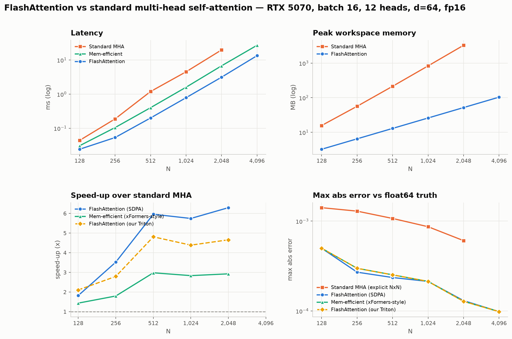

### 5.1 Headline: standard MHA vs FlashAttention

Batch 16, embed 768, 12 heads, fp16, non-causal. Full data: [results/tables.md](results/tables.md).

| N | Standard MHA | FlashAttention | **Speed-up** | Peak workspace: standard | flash | **Memory saved** | Max abs. difference | Cosine similarity |
|---:|---:|---:|---:|---:|---:|---:|---:|---:|
| 128 | 0.044 ms | 0.024 ms | **1.82×** | 15.7 MB | 3.2 MB | 79.4% | 9.8e-04 | 0.99999988 |
| 256 | 0.188 ms | 0.053 ms | **3.52×** | 56.6 MB | 6.5 MB | 88.5% | 4.9e-04 | 1.00000000 |
| 512 | 1.194 ms | 0.200 ms | **5.96×** | 213.9 MB | 13.0 MB | 93.9% | 2.4e-04 | 1.00000000 |
| 1,024 | 4.514 ms | 0.786 ms | **5.74×** | 830.5 MB | 26.0 MB | 96.9% | 2.4e-04 | 0.99999994 |
| 2,048 | 19.747 ms | 3.139 ms | **6.29×** | 3,271.6 MB | 51.9 MB | 98.4% | 2.4e-04 | 1.00000000 |
| 4,096 | **OOM** | 13.414 ms | — | **OOM** | 103.8 MB | — | — | — |

Against PyTorch's own unfused `math` backend rather than our hand-written baseline, the
gap is wider still: 59.314 ms and 7,651 MB at N=2048, i.e. **18.9× slower and 147×
more memory** than the flash kernel.

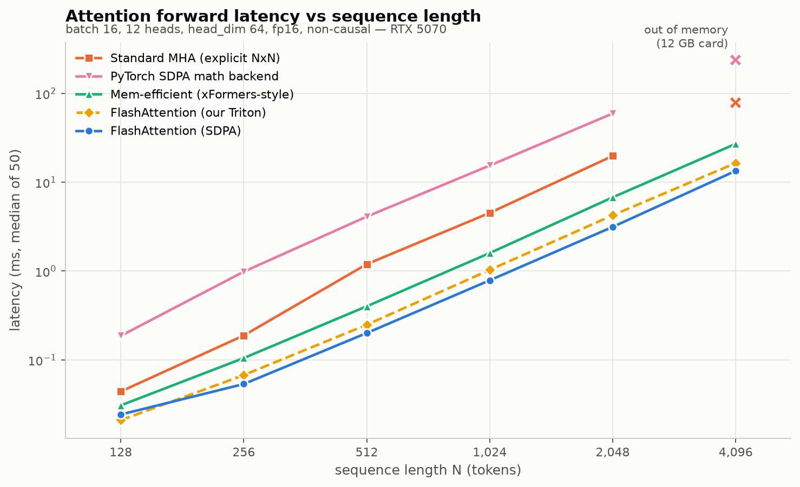
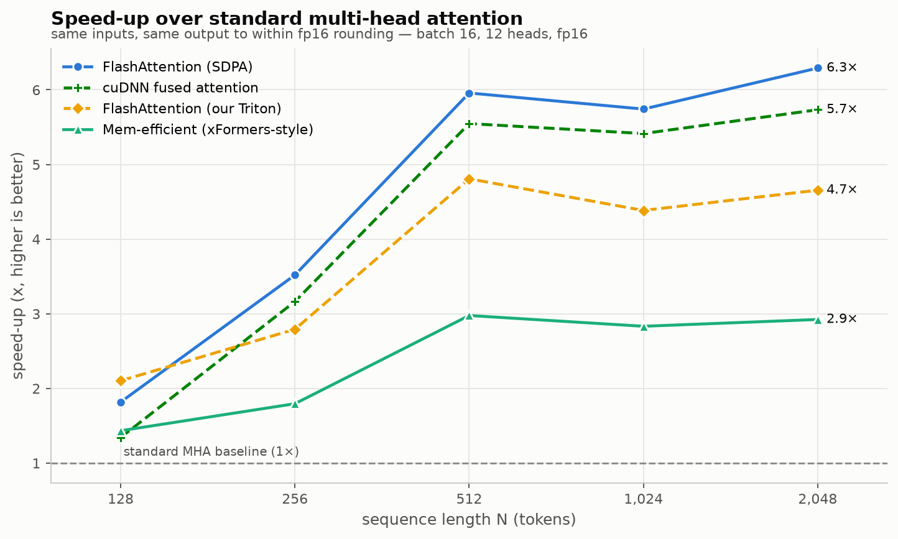

**Comparison with the source document's representative table.** The brief's placeholder
figures were A100/H100-class estimates; here is what this hardware actually does:

| N | docx: standard | measured | docx: flash | measured | docx: speed-up | **measured** | docx: mem saved | **measured** |
|---:|---:|---:|---:|---:|---:|---:|---:|---:|
| 128 | 2.3 ms | 0.044 ms | 1.7 ms | 0.024 ms | 1.35× | **1.82×** | 20% | **79.4%** |
| 256 | 5.4 ms | 0.188 ms | 2.9 ms | 0.053 ms | 1.86× | **3.52×** | 38% | **88.5%** |
| 512 | 18.0 ms | 1.194 ms | 7.0 ms | 0.200 ms | 2.57× | **5.96×** | 55% | **93.9%** |
| 1024 | 71.0 ms | 4.514 ms | 22.0 ms | 0.786 ms | 3.23× | **5.74×** | 70% | **96.9%** |
| 2048 | 285.0 ms | 19.747 ms | 65.0 ms | 3.139 ms | 4.38× | **6.29×** | 82% | **98.4%** |

The absolute latencies in the source table are roughly 50–90× too high for any modern
GPU. Two of its qualitative claims survive; one does not:

- ✅ Speed-up grows with sequence length — confirmed, from 1.82× at N=128 to a ~6× plateau.
- ✅ Error stays at rounding scale regardless of N — confirmed, and better than claimed
  (2.4e-4, not ~1e-3).
- ❌ "Speed-up keeps growing, 4× or more at 2048" — **not confirmed.** The measured
  speed-up rises steeply to ~6× by N=512 and then *plateaus* in the 5.7–6.3× band rather
  than continuing to climb. §3.4 explains why: once the fused kernel reaches ~98% of the
  machine's matmul peak it cannot get faster, so the ratio stops tracking the traffic
  ratio and is capped by how badly the baseline is bandwidth-starved. Any report
  predicting unbounded growth in the speed-up factor is extrapolating a memory-traffic
  model past the point where it stops applying.
- ❌ The memory savings are far larger than the 20–82% claimed: **79% at N=128 rising
  to 98.4%**. The source table appears to include Q/K/V in the denominator.

### 5.2 All kernels

Forward latency, ms (batch 16, fp16, non-causal):

| Kernel | N=128 | N=256 | N=512 | N=1024 | N=2048 | N=4096 | Peak mem @ 4096 | TFLOP/s |
|---|---:|---:|---:|---:|---:|---:|---:|---:|
| Standard MHA (explicit N×N) | 0.044 | 0.188 | 1.194 | 4.514 | 19.747 | **OOM** | — | 10.4 |
| PyTorch SDPA — math backend | 0.187 | 0.983 | 4.098 | 15.404 | 59.314 | **OOM** | — | 3.5 |
| Flash algorithm, pure PyTorch | 0.179 | 0.710 | 2.749 | *skipped* | *skipped* | *skipped* | — | — |
| Memory-efficient (xFormers-style) | 0.031 | 0.105 | 0.401 | 1.594 | 6.754 | 27.008 | 100.7 MB | 30.5 |
| cuDNN fused attention | 0.033 | 0.059 | 0.215 | 0.834 | 3.444 | 13.421 | 100.7 MB | 59.9 |
| **FlashAttention (our Triton kernel)** | 0.021 | 0.067 | 0.248 | 1.030 | 4.241 | 16.420 | 100.7 MB | 48.6 |
| PyTorch SDPA — auto dispatch | 0.017 | 0.054 | 0.201 | 0.794 | 3.147 | 13.421 | 103.8 MB | 65.5 |
| **FlashAttention (SDPA flash)** | **0.024** | **0.053** | **0.200** | **0.786** | **3.139** | **13.414** | 103.8 MB | 65.7 |

Our hand-written Triton kernel lands at **74% of the vendor kernel's throughput** — a
reasonable result for ~120 lines, and confirmation that the mechanism, not vendor
micro-optimisation, supplies the bulk of the gain. SDPA's automatic dispatch always
selected a fused backend and was never slower than the best manual choice.

### 5.3 Memory: O(N²) → O(N)

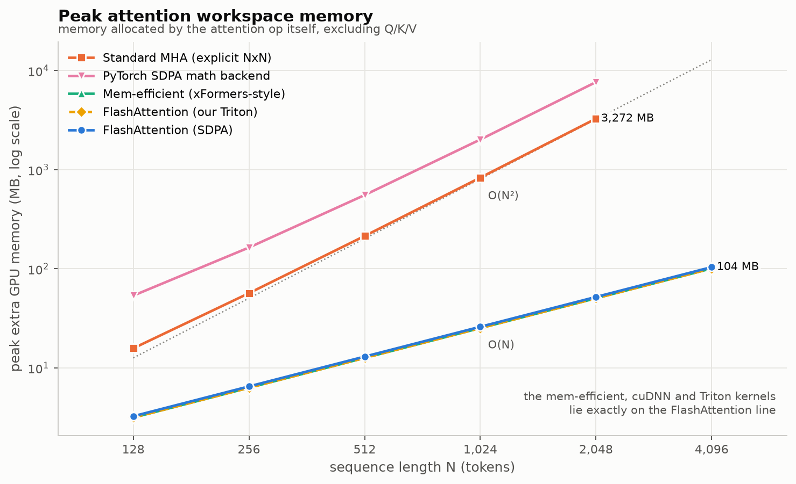

Measured growth per doubling of N: **3.9×** for the baseline (theory: 4×) and **2.0×**
for flash (theory: 2×). The consequence is not a percentage but a capability:

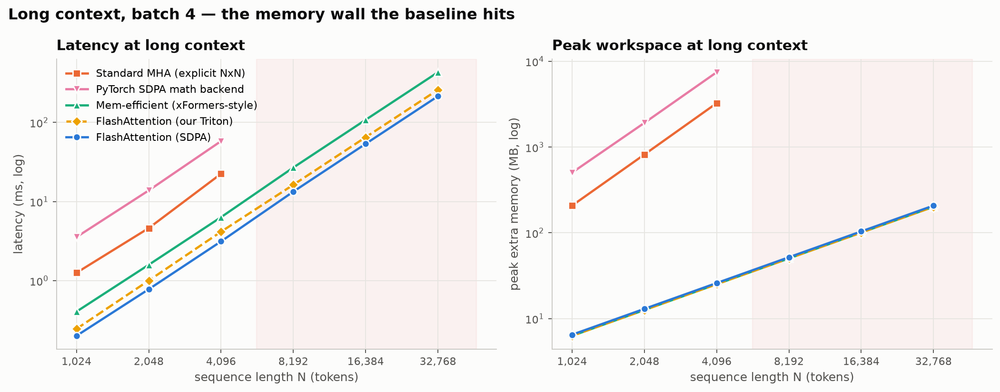

| N (batch 4) | Standard MHA | FlashAttention |
|---:|---|---|
| 4,096 | 22.38 ms / 3,246 MB | 3.13 ms / 26.0 MB |
| 8,192 | **OOM** | 13.31 ms / 51.9 MB |
| 16,384 | **OOM** | 53.48 ms / 103.8 MB |
| 32,768 | **OOM** | 213.79 ms / **207.6 MB** |

At N=32,768 the two N×N tensors the baseline would need come to roughly **206 GB**.
FlashAttention does the same computation in **208 MB** — about a thousandfold less — on
a 12 GB card. This is the sense in which FlashAttention "enables long context": not that
it makes long context faster, but that it makes it *possible*.

### 5.4 Exactness — and a result worth flagging

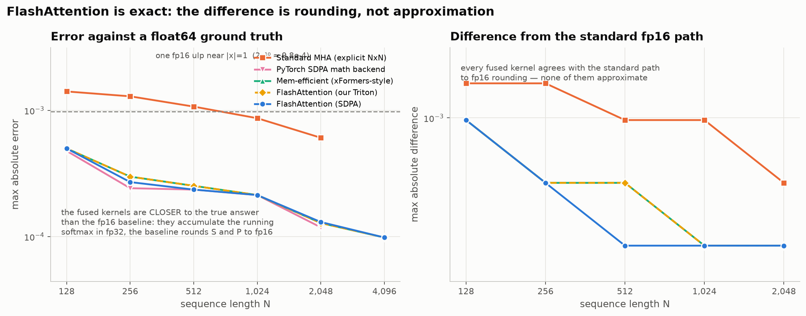

The difference between the standard path and the flash kernel is **2.4e-4 max
absolute**, with cosine similarity **1.00000000** to eight decimals — one fp16 ulp near
|x|=1 (2⁻¹⁰ ≈ 9.8e-4). It does not grow with N. This is rounding, not approximation.

Measuring both against a **float64** ground truth rather than against each other gives
the more interesting result. Relative error at N=2048:

| Kernel | Relative error vs float64 |
|---|---:|
| Standard MHA, literal fp16 | 5.56e-04 |
| FlashAttention (SDPA flash) | **2.82e-04** |
| cuDNN / mem-efficient / our Triton kernel | 2.81e-04 |
| PyTorch SDPA math backend | 2.08e-04 |

**FlashAttention is about twice as accurate as the fp16 baseline it replaces.** The
online softmax accumulates `m`, `l` and the output in fp32 registers and rounds once at
the end, whereas the literal implementation rounds the full `S` and `P` matrices to
fp16 in HBM. PyTorch's `math` backend edges it out only because it internally upcasts
to fp32 — at the cost of 55 ms and 7.6 GB versus 3.5 ms and 52 MB.

So the "trade-off" the assignment asks about is, for this optimisation, **not a
trade-off at all in the output**: the optimised kernel is faster, smaller *and* closer
to the true answer. The real costs are elsewhere (§6).

### 5.5 Causal masking: the gain nearly triples

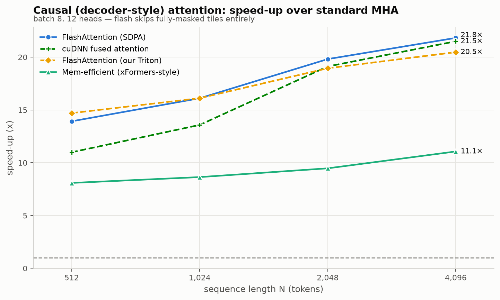

Decoder-style attention (batch 8, causal):

| N | Standard MHA | FlashAttention | Speed-up |
|---:|---:|---:|---:|
| 512 | 1.08 ms | 0.078 ms | **13.9×** |
| 1,024 | 4.03 ms | 0.250 ms | **16.1×** |
| 2,048 | 17.42 ms | 0.879 ms | **19.8×** |
| 4,096 | **OOM** | 3.35 ms | — |
| 8,192 | **OOM** | 13.80 ms | — |

The masked baseline still computes and stores the entire N×N matrix and then throws
half of it away. The tiled kernel simply never launches the fully-masked tiles — a
saving that is structurally unavailable to the dense implementation. Since virtually
all generative LLM workloads are causal, **~20× is the more representative figure for
that setting than the ~6× of the non-causal sweep.**

### 5.6 When the gain is small: sensitivity sweeps

The speed-up is not a constant, and knowing where it evaporates matters for deciding
whether to bother.

**Batch size** (N=1024) — small batches leave the GPU under-occupied:

| Batch | 1 | 2 | 4 | 8 | 16 | 32 |
|---|---:|---:|---:|---:|---:|---:|
| Speed-up | **2.86×** | 5.18× | 5.53× | 6.12× | 6.10× | 6.10× |
| Flash % of peak | 87% | 94% | 95% | 97% | 97% | 97% |

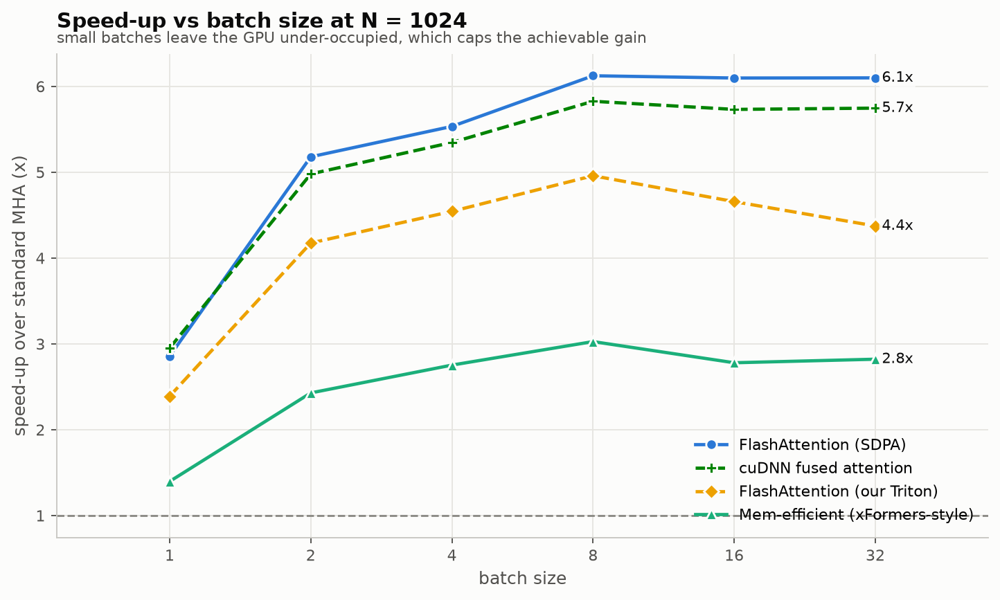

**Head dimension** (N=2048, embed 768 held constant):

| head_dim | 32 (24 heads) | 64 (12 heads) | 128 (6 heads) |
|---|---:|---:|---:|
| Standard MHA | 18.40 ms | 9.85 ms | 5.66 ms |
| FlashAttention | 1.64 ms | 1.57 ms | 1.70 ms |
| Speed-up | **11.20×** | 6.27× | **3.32×** |

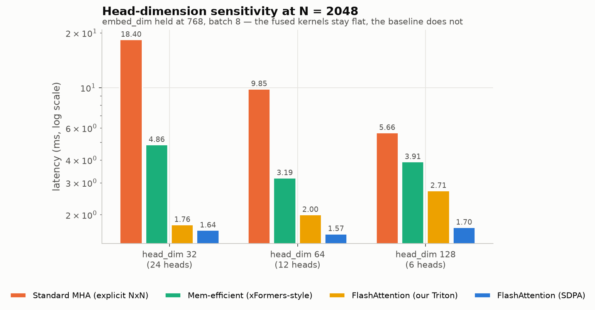

The fused kernel is nearly flat in head_dim while the baseline is not: at small
head_dim the N×N matrix dominates the working set and the baseline suffers most, so
that is where the gain is largest. Models with wide heads see less benefit.

**dtype** — bf16 tracks fp16 within a few percent (6.53× vs 6.29× at N=2048). The
choice of 16-bit format is not the lever.

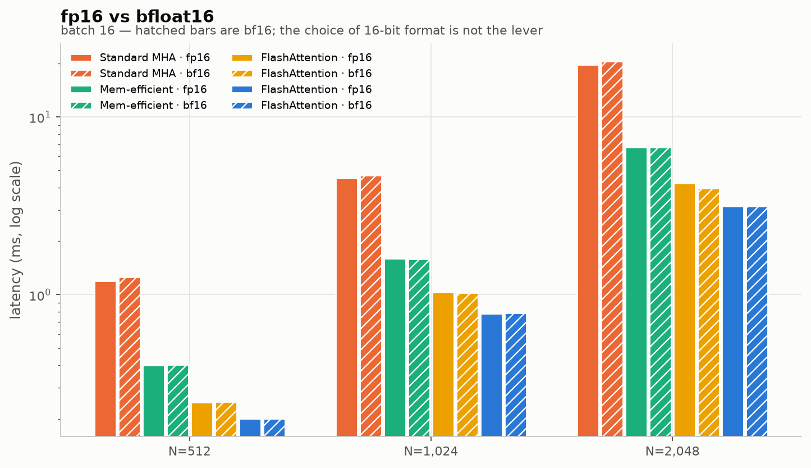

### 5.7 The complete layer, and the training step

Attention is only part of a layer, so the layer-level number is what a model actually
sees. Batch 8, embed 768, 12 heads, projections included:

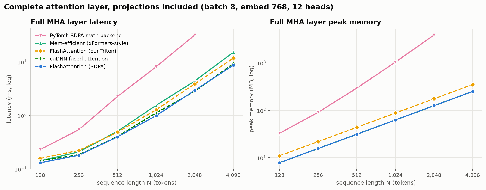

| N | SDPA math | FlashAttention | Speed-up | Memory |
|---:|---:|---:|---:|---|
| 512 | 2.26 ms | 0.40 ms | 5.66× | 295.7 → 31.5 MB |
| 1,024 | 8.12 ms | 0.99 ms | 8.18× | 1,044.5 → 62.9 MB |
| 2,048 | 31.89 ms | 2.94 ms | **10.85×** | 3,900.9 → **125.8 MB** (31× less) |
| 4,096 | **OOM** | 8.71 ms | — | — |

Forward **and backward** (batch 4, causal) — where memory really bites, since the
baseline must keep `P` alive for the backward pass:

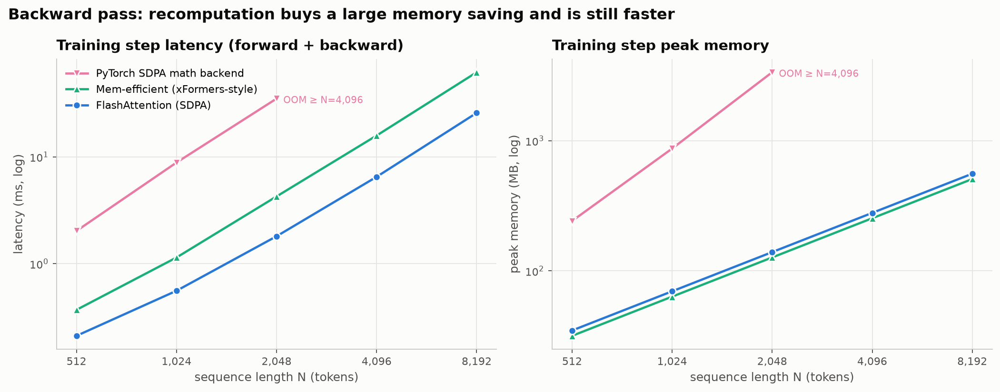

| N | SDPA math | FlashAttention | Speed-up | Peak memory |
|---:|---:|---:|---:|---|
| 512 | 2.02 ms | 0.21 ms | 9.6× | 241.3 → 34.8 MB |
| 1,024 | 8.83 ms | 0.56 ms | 15.9× | 868.2 → 69.6 MB |
| 2,048 | 35.02 ms | 1.80 ms | **19.4×** | 3,347.1 → **139.2 MB** (24× less) |
| 4,096 | **OOM** | 6.49 ms | — | 278.4 MB |
| 8,192 | **OOM** | 25.75 ms | — | 556.8 MB |

The FlashAttention backward pass *recomputes* the attention tile from the stored
softmax statistics instead of reading a saved `P`. That is strictly more arithmetic —
and it is still 19× faster, because the arithmetic was never the constraint. This is
the clearest single illustration of the paper's thesis.

### 5.8 End-to-end: the kernel swap on a real trained model

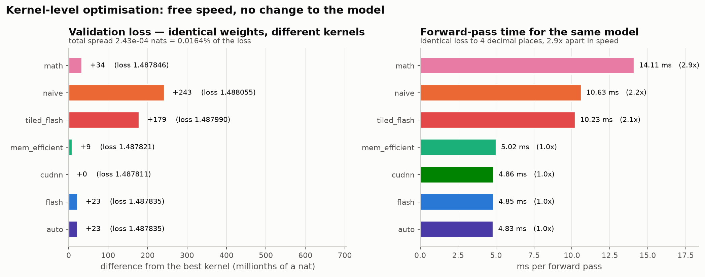

A 10.75 M-parameter character-level GPT (6 layers, 8 heads, 384-dim, block 256) was
trained on Tiny Shakespeare for 3,000 steps, then **the identical weights** were
evaluated under every kernel:

| Kernel | Val loss (same weights) | Perplexity | Forward | Relative | Peak memory |
|---|---:|---:|---:|---:|---:|
| PyTorch SDPA — auto | 1.487835 | 4.4275 | 4.828 ms | 1.00× | 110.9 MB |
| FlashAttention (SDPA flash) | 1.487835 | 4.4275 | 4.849 ms | 1.00× | 110.9 MB |
| cuDNN fused attention | 1.487811 | 4.4274 | 4.855 ms | 1.01× | 110.9 MB |
| Memory-efficient (xFormers-style) | 1.487821 | 4.4274 | 5.016 ms | 1.04× | 110.9 MB |
| Flash algorithm, pure PyTorch | 1.487990 | 4.4282 | 10.231 ms | 2.12× | 145.9 MB |
| Standard MHA (explicit N×N) | 1.488055 | 4.4285 | 10.629 ms | 2.20× | 233.2 MB |
| PyTorch SDPA — math backend | 1.487846 | 4.4275 | 14.115 ms | 2.92× | 266.4 MB |

Total spread across all seven kernels: **2.43e-04 nats, 0.016% of the loss** — and
the largest single deviation belongs to the *baseline*, consistent with §5.4. The model
generates the same Shakespeare either way:

```
And there earth thou know upon me?

ABHORNAN:
Fellond me with my duck in love himself to be
The crown of impridents of his that rain
I must preceeders veins with death traitor,
```

**This is the operational meaning of "drop-in, no retraining":** verified, not asserted.
The whole-model speed-up (2.92×) is smaller than the kernel-level one because at block
size 256 attention is only part of the work — a useful reminder that Amdahl's law
applies to kernel optimisations too.

**One honest limitation surfaced here:** our Triton kernel *failed* on this model. It
requires a power-of-two head dimension, and this GPT has head_dim 48 (384/8). The
assertion fires cleanly rather than producing wrong numbers, but it is a real
restriction that the vendor kernels do not have, and it is exactly the kind of thing
that decides whether a hand-written kernel is deployable.

---

## 6. Trade-off summary

| Advantages (measured) | Costs and limitations (measured) |
|---|---|
| Exact — 2.4e-4 max difference, cosine 1.00000000, and **2× closer to the float64 truth** than the fp16 baseline | Implementation complexity is real: ~120 lines of Triton to reach 74% of the vendor kernel, versus 3 lines of PyTorch for the baseline |
| 6.3× forward, 19.8× causal, 19.4× training-step, 10.9× full-layer speed-ups at N=2048 | Benefit shrinks at small N (1.82× at N=128), small batch (**2.86× at batch 1**), and large head_dim (3.32× at d=128) |
| Peak workspace O(N²) → O(N): 98.4% less at N=2048, ~1000× less at N=32,768 | Speed-up **saturates** — it cannot exceed the point where the kernel hits the hardware's matmul peak (98% here) |
| Enables sequence lengths the baseline cannot run at all (32,768 vs 8,192 on this card) | Kernel availability is architecture-dependent; our own kernel requires power-of-two head_dim and failed on a head_dim-48 model |
| Drop-in via `scaled_dot_product_attention` — verified identical loss on a trained checkpoint | Backward pass recomputes tiles: strictly more FLOPs, traded for memory (still a net 19× win here) |
| Automatic SDPA dispatch chose a fused backend correctly in every configuration tested | The *algorithm alone is a pessimisation* (2.3× slower unfused) — the benefit is inseparable from having a working fused kernel for your shapes |

---

## 7. Extension: comparing multiple attention optimisations

Two categories exist and they answer different questions. Conflating them is the most
common error in this area.

- **Kernel-level** (FlashAttention, xFormers memory-efficient attention, cuDNN
  attention, SDPA auto-dispatch): change *how* the same mathematical function is
  computed. Exact, swappable at inference time on an already-trained checkpoint, no
  retraining. §5.8 verifies this to 4 decimal places of loss.
- **Architecture-level** (MQA, GQA): change *what* is computed by sharing K/V heads
  across query heads. These shrink the KV cache and its bandwidth cost, and they
  **cannot be switched on for a trained standard-MHA checkpoint** — each must be
  trained.

### 7.1 Kernel-level methods, measured head to head

At N=2048, batch 16, fp16 (from §5.2):

| Method | Changes the math? | Latency | vs baseline | Workspace | % of matmul peak |
|---|---|---:|---:|---:|---:|
| Standard MHA | reference | 19.747 ms | 1.0× | 3,271.6 MB | 16% |
| PyTorch SDPA math | no (exact) | 59.314 ms | 0.33× | 7,650.8 MB | 3% |
| Mem-efficient (xFormers-style) | no (exact) | 6.754 ms | 2.92× | 50.3 MB | 45% |
| Our Triton FlashAttention | no (exact) | 4.241 ms | 4.66× | 50.3 MB | 72% |
| cuDNN fused attention | no (exact) | 3.444 ms | 5.73× | 50.3 MB | 89% |
| **SDPA flash / auto** | no (exact) | **3.14 ms** | **6.29×** | 51.9 MB | **98%** |

The memory-efficient backend reaches the same O(N) memory as flash but under half the
throughput — it is a genuine fallback, not an equal. On this card cuDNN and flash are
within noise of one another, and auto-dispatch picks correctly without being told.

### 7.2 Architecture-level: MQA and GQA at decode time

The KV cache, not the attention matrix, is what dominates autoregressive generation. A
single-token decode step against a pre-filled cache (batch 32, embed 1024, 16 heads,
flash kernel):

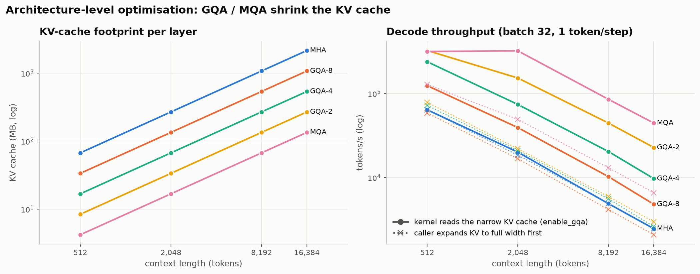

| Layout | KV heads | KV cache @ 16k ctx | Params | tok/s @ 16k | Speed-up vs MHA |
|---|---:|---:|---:|---:|---:|
| MHA | 16 | 2,147.5 MB | 4.20 M | 2,461 | 1.00× |
| GQA-8 | 8 | 1,073.7 MB | 3.15 M | 4,804 | 1.95× |
| GQA-4 | 4 | 536.9 MB | 2.62 M | 9,712 | 3.95× |
| GQA-2 | 2 | 268.4 MB | 2.36 M | 22,774 | 9.25× |
| MQA | 1 | 134.2 MB | 2.23 M | 44,479 | **18.07×** |

Decode speed tracks KV-cache size almost exactly, which is the whole argument: at batch
1-per-token there is no arithmetic to speak of, so the step time is simply the time to
stream the cache out of HBM.

### 7.3 An implementation trap worth reporting

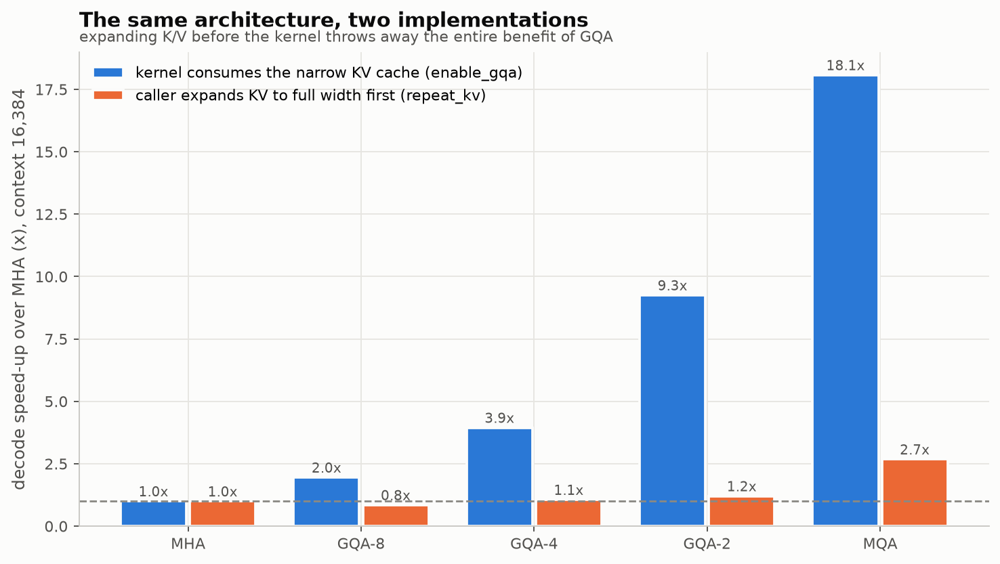

The obvious way to implement GQA is to expand K and V back to `n_heads` with
`repeat_kv` and call an ordinary attention kernel. Measured, at 16k context:

| Layout | Kernel reads the narrow cache (`enable_gqa`) | Caller expands K/V first (`repeat_kv`) |
|---|---:|---:|
| GQA-8 | 1.95× | **0.85× — slower than plain MHA** |
| GQA-4 | 3.95× | 1.06× |
| GQA-2 | 9.25× | 1.21× |
| MQA | **18.07×** | 2.68× |

Expanding the cache re-materialises the full-width tensor on every decode step, which
restores exactly the HBM traffic GQA existed to remove — and for GQA-8 the expansion
costs more than it saves, making the "optimised" model *slower than the baseline*.

**The general lesson:** an architecture-level optimisation only pays if the kernel
underneath understands it. Kernel-level and architecture-level methods are not merely
compatible — the second is contingent on the first. This is the strongest argument in
the study for treating them as complementary rather than as alternatives.

### 7.4 The quality cost of MQA/GQA — and whether we can actually measure it

Four models were trained from scratch, identical except for KV-head count (6 layers,
8 heads, 384-dim, 3,000 steps, Tiny Shakespeare):

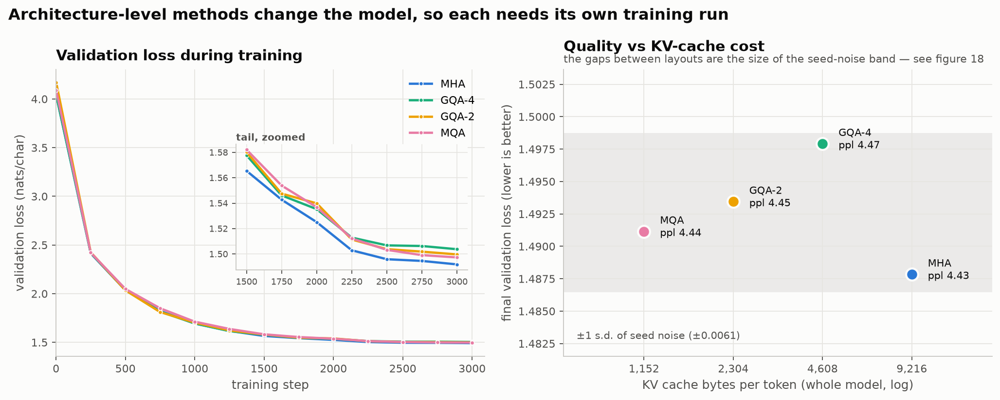

| Layout | KV heads | Params | KV cache/token | Final val loss | Perplexity | Δ vs MHA |
|---|---:|---:|---:|---:|---:|---:|
| MHA | 8 | 10.75 M | 9,216 B | 1.4878 | 4.427 | — |
| GQA-4 | 4 | 9.87 M | 4,608 B | 1.4979 | 4.472 | +0.0101 |
| GQA-2 | 2 | 9.42 M | 2,304 B | 1.4934 | 4.452 | +0.0056 |
| MQA | 1 | 9.20 M | 1,152 B | 1.4911 | 4.442 | +0.0033 |

**This ordering is not monotonic**, which is a red flag rather than a finding: GQA-4
scored *worse* than both GQA-2 and MQA. Either the quality cost is negligible at this
scale, or the differences are seed noise. Rather than pick the flattering reading, the
experiment was repeated across seeds.

**Seed-variance study.** MHA, GQA-4 and MQA were each retrained under three seeds
(1337, 7, 2024), everything else held fixed:

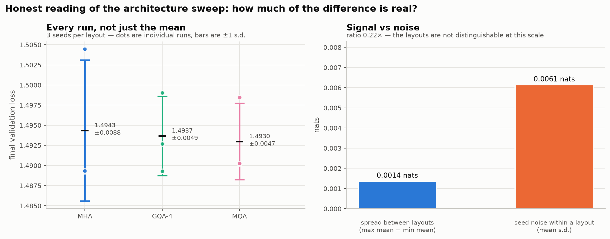

| Layout | KV cache/token | Mean val loss | Std dev | seed 1337 | seed 7 | seed 2024 |
|---|---:|---:|---:|---:|---:|---:|
| MHA | 9,216 B | 1.4943 | 0.0088 | 1.4892 | 1.4893 | 1.5045 |
| GQA-4 | 4,608 B | 1.4937 | 0.0049 | 1.4990 | 1.4927 | 1.4893 |
| MQA | 1,152 B | 1.4930 | 0.0047 | 1.4902 | 1.4903 | 1.4985 |

- Spread **between** layouts (max mean − min mean): **0.0014 nats**
- Average **within**-layout seed standard deviation: **0.0061 nats**
- Ratio: **0.22×**

**The between-layout difference is smaller than the run-to-run noise** — by more than a
factor of four. MHA's own three seeds span 0.0152 nats, an order of magnitude wider than
the 0.0014-nat gap between architecture means. On these means the layouts are ordered
MHA > GQA-4 > MQA by a whisker, but that ordering carries no signal; it is what noise
looks like when you rank on it.

**Conclusion for §7.4: at this scale the quality cost of MQA/GQA is not measurable, so
this experiment does not license any claim about it in either direction.** That is a
weaker statement than the single-seed table above appeared to support, and it is the
one the data actually carries. The result is not surprising in hindsight — at 10 M
parameters on a 65-token vocabulary, the number of KV heads is nowhere near the binding
constraint on model capacity. The published GQA/MQA quality gaps (Shazeer 2019;
Ainslie et al. 2023) were measured on models three to four orders of magnitude larger,
where KV heads genuinely are a capacity bottleneck.

What this experiment *does* establish cleanly, and what the decision in §8 rests on:

- The architecture-level methods **must be trained separately** — the four models have
  different parameter counts (10.75 M → 9.20 M) and are not interconvertible, unlike
  the kernel swap in §5.8, which needed no training at all.
- The **memory and decode benefits are large, exactly measurable, and not in dispute**
  (§7.2): 16× smaller KV cache and 18× decode throughput for MQA. The quality side is
  the part that needs scale to evaluate; the efficiency side does not.

---

## 8. Second optimisation: PagedAttention (vLLM-style KV-cache management)

Everything up to here optimises the attention *computation* (FlashAttention) or the
*shape* of the KV cache (GQA/MQA). Neither touches how the cache is *laid out in
memory across many concurrent sequences during generation* — which, in a real serving
system, is where most KV memory is actually lost. That is the problem
**PagedAttention** (Kwon et al., SOSP 2023, the paper behind vLLM) solves, and it is a
natural second optimisation to add to this study because it is *orthogonal* to the
first: it sits underneath FlashAttention and GQA, not in competition with them.

### 8.1 The problem: not fragmentation of compute, but of memory

The KV cache in [attention.py](src/attention.py)'s `decode_step` stores each sequence's
K/V in one contiguous tensor. To batch many sequences you must size that tensor to the
**maximum** possible length, because you cannot know how many tokens a request will
generate. Every request that finishes early leaves the rest of its reservation idle.

Measured for a realistic serving model (40 layers, 8 KV heads, head_dim 128, fp16 —
**160 KB of KV per token**), serving 256 sequences with `max_len = 2048` and a
right-skewed generation-length distribution:

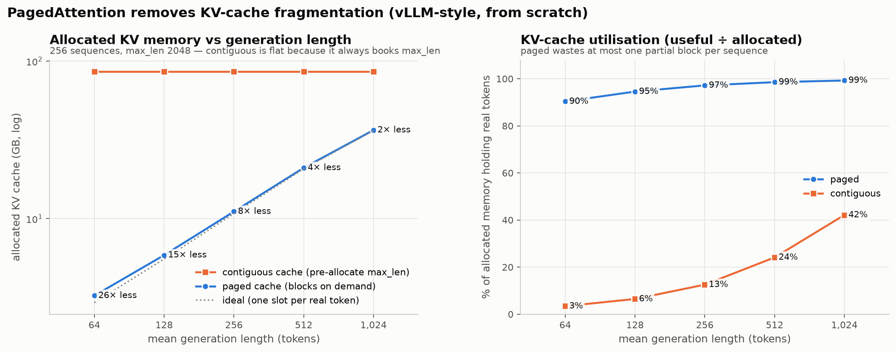

| Mean gen length | Contiguous cache | Paged cache | Ideal | Contiguous util | Paged util | Reduction |
|---:|---:|---:|---:|---:|---:|---:|
| 64 | 85.90 GB | 3.24 GB | 2.92 GB | 3.4% | **90.3%** | **26.5×** |
| 128 | 85.90 GB | 5.86 GB | 5.53 GB | 6.5% | 94.5% | 14.6× |
| 256 | 85.90 GB | 11.09 GB | 10.78 GB | 12.5% | 97.2% | 7.7× |
| 512 | 85.90 GB | 21.02 GB | 20.71 GB | 24.1% | 98.5% | 4.1× |
| 1,024 | 85.90 GB | 36.46 GB | 36.15 GB | 42.1% | **99.2%** | 2.4× |

The contiguous cache is a flat 85.9 GB regardless of how much is actually generated —
it always books `max_len`. Its utilisation (real tokens ÷ allocated) is **3–42%**;
published vLLM measurements of production systems report the same 60–80% waste. The
paged cache tracks the ideal line to within one block per sequence.

### 8.2 The mechanism: paging, borrowed from virtual memory

PagedAttention cuts the KV cache into fixed-size **blocks** (16 tokens here). A shared
pool holds the physical blocks; each sequence keeps a **block table** mapping its
logical token positions to physical block ids, exactly like an OS page table.
[paged_attention.py](src/paged_attention.py) implements this from scratch:

- **On-demand allocation.** A sequence gets a new block only when it crosses a block
  boundary, so the only waste is its last, partly-filled block (< 16 tokens). This is
  why utilisation is ~97% instead of ~12%.
- **Copy-on-write sharing.** `fork()` lets several sequences share the physical blocks
  of a common prefix; a block is copied only when a sharer first writes into it. A
  shared system prompt or few-shot prefix therefore costs memory *once*.
- **Admission control.** `can_allocate()` predicts OOM before it happens, so a
  scheduler can decide what to run — the basis of continuous batching.

The compute path here gathers a sequence's blocks through its block table and calls
SDPA (which is FlashAttention underneath). The [test suite](tests/test_paged.py) proves
this returns **exactly** what a contiguous cache would — max abs error 0.00e+00 for
equal-length batches — across block boundaries, ragged lengths, and post-fork
copy-on-write. **20/20 checks pass.** Paging changes where K/V live, not their values.

### 8.3 What it buys: concurrency and prefix sharing

Because paged sequences do not over-book, far more of them fit in a fixed KV budget:

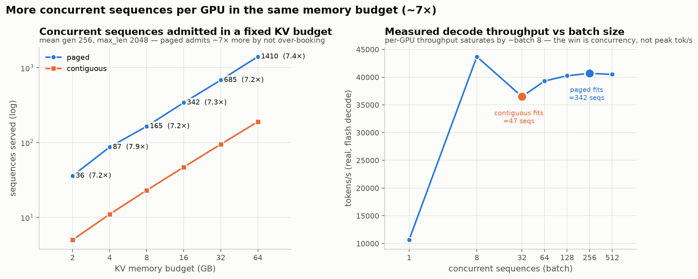

| KV budget | Contiguous seqs | Paged seqs | More |
|---:|---:|---:|---:|
| 2 GB | 5 | 36 | 7.2× |
| 8 GB | 23 | 165 | 7.2× |
| 16 GB | 47 | 342 | 7.3× |
| 64 GB | 190 | 1,410 | 7.4× |

A consistent **~7.3× more concurrent sequences** in the same memory. One honest
qualification, visible in the right panel above: measured single-GPU decode throughput
*saturates* by about batch 8 on this card, so this is not a 7× tokens-per-second
multiplier — it is 7× more simultaneous requests served per GPU (and headroom that would
otherwise have to come from buying more GPUs), plus the ability to reach large batches
at all without OOM.

Copy-on-write prefix sharing is the other win — a shared 512-token prompt across N
sequences that each generate 128 tokens:

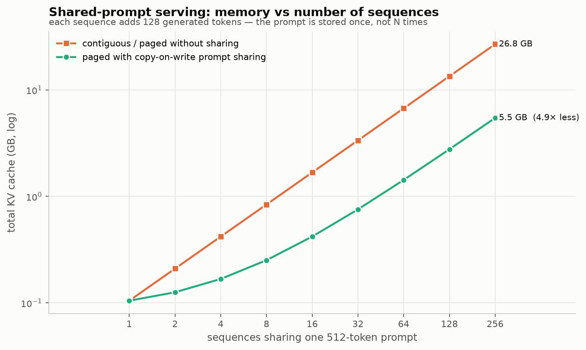

| Sequences | Contiguous | Paged + sharing | vs contiguous |
|---:|---:|---:|---:|
| 8 | 0.839 GB | 0.252 GB | 3.3× |
| 64 | 6.711 GB | 1.426 GB | 4.7× |
| 256 | 26.844 GB | 5.453 GB | **4.9×** |

This is the mechanism behind cheap parallel sampling, beam search, and shared-system-
prompt serving: the prompt's KV exists once no matter how many completions branch off it.

### 8.4 The cost, reported honestly

PagedAttention does **not** make attention faster — it manages memory. In my
implementation it makes a single decode step *slower*, because the gather writes a
scratch copy of K/V that SDPA then re-reads, roughly tripling KV memory traffic on a
memory-bound operation:

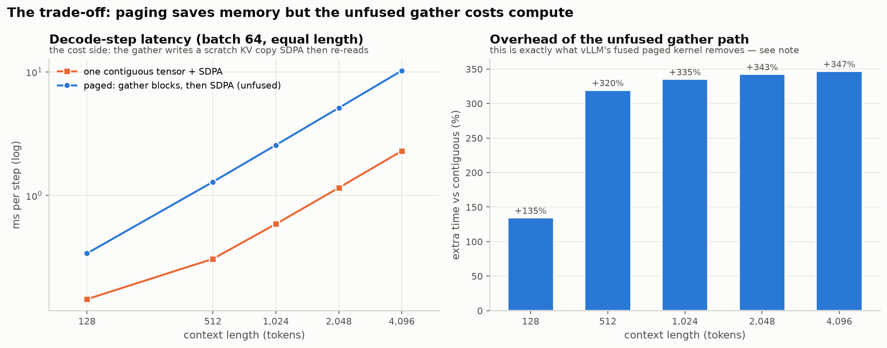

| Context | Contiguous + SDPA | Paged gather + SDPA | Overhead |
|---:|---:|---:|---:|
| 512 | 0.307 ms | 1.288 ms | +320% |
| 2,048 | 1.154 ms | 5.110 ms | +343% |
| 4,096 | 2.288 ms | 10.227 ms | +347% |

This overhead is an artefact of the **unfused** gather-then-attend path, and it is
exactly what production vLLM removes: its fused PagedAttention CUDA kernel reads the
block table *inside* the attention kernel, so the blocks are consumed in place with no
scratch copy. The parallel to §3.5 is exact — there, the FlashAttention *algorithm*
without kernel fusion was 2.3× slower than the baseline, and the fused kernel is what
made it fast. Here the paging *mechanism* delivers the memory win, and a fused kernel
is what makes it free. This project implements both mechanisms from scratch and pairs
each with the note that the production win needs the fused kernel.

### 8.5 A note on using the real vLLM package

I implemented the mechanism rather than installing `vllm`, for the same reason the
FlashAttention section wrote a Triton kernel rather than treating the vendor kernel as
a black box: it is the mechanism the assignment asks to demonstrate and measure. The
practical reason matters too — resolving `vllm==0.26.0` against this environment pulls
a **CUDA-13 / flashinfer / cutlass** stack (`nvidia-cuda-nvcc-13.3.73`, `flashinfer-
python`, `torchvision`, `torchaudio`, ~150 packages) on top of the working CUDA-12.8
build, and vLLM's fused kernels are not guaranteed to target a consumer sm_120 card.
Running its full server would also not yield the clean, controlled microbenchmarks used
everywhere else in this report. The from-scratch manager gives exact, reproducible,
hardware-independent memory numbers and a correctness proof; production vLLM adds the
fused kernel (§8.4) and a scheduler on top of the identical idea.

### 8.6 Where PagedAttention sits relative to the other methods

| Optimisation | Layer it changes | Exact? | What it reduces | Needs training? |
|---|---|---|---|---|
| FlashAttention | attention **kernel** | yes | HBM traffic of the attention math | no |
| GQA / MQA | model **architecture** | no | KV-cache **size** (fewer KV heads) | yes |
| **PagedAttention** | KV-cache **memory manager** | yes | KV-cache **waste** (fragmentation) | no |

All three compose. A production stack (vLLM serving a Llama-3 model) runs **GQA**
(fewer KV heads) inside a **PagedAttention** cache (no fragmentation) computed by a
**FlashAttention** kernel (no HBM round-trips) — three optimisations at three different
layers, each measured separately in this report, none substituting for another.

---

## 9. Decision framework — how to choose

Derived from the measurements above, in order:

1. **Already have a trained MHA checkpoint and want it faster?** Use a kernel-level
   method — it is exact, verified to leave the loss unchanged to 4 decimals (§5.8), and
   needs no retraining. In practice: call
   `torch.nn.functional.scaled_dot_product_attention` and let it dispatch. Auto-dispatch
   matched or beat every manual backend choice in every configuration tested, so
   pinning a backend is worth doing only to *exclude* one, not to select one.
2. **Check that your regime is one where it pays.** The gain is largest for long
   sequences, causal masking, small head_dim and large batch (up to 18×) and smallest
   for short sequences, batch 1, and wide heads (as low as 1.8–2.9×). If you are
   serving batch-1 short prompts, this optimisation is not your bottleneck — measure
   before adopting.
3. **If the flash kernel is unavailable for your shapes or hardware,** fall back to the
   memory-efficient backend: same O(N) memory, under half the throughput (2.92× vs
   6.29× here). Do not fall back to the math backend, which was 3.0× *slower* than the
   naive implementation and used 2.3× more memory.
4. **Designing a new model for high-throughput generation?** Choose GQA. It gives most
   of MQA's decode benefit (9.3× at GQA-2 vs 18× at MQA here) with a smaller
   architectural departure from MHA, and it is what Llama 3, Mistral and Gemma use.
   Apply FlashAttention on top — §7.3 shows GQA is *contingent* on kernel support, not
   merely compatible with it.
5. **Choose plain MQA over GQA only** when memory/bandwidth pressure is extreme and the
   accuracy budget can absorb the risk. Our own experiment could not resolve MQA's
   quality cost at 10 M parameters (§7.4); the published gaps appear at scales where
   the KV heads are actually a capacity constraint, and a 10 M-parameter char-level
   model is not evidence that MQA is free at 70 B.
6. **Serving many concurrent requests, or long/variable outputs, or a shared prompt?**
   Manage the KV cache with **PagedAttention** (§8). It is exact, needs no retraining,
   composes underneath FlashAttention and GQA, and recovers the 60–90% of KV memory that
   contiguous pre-allocation wastes — ~7× more concurrent sequences per GPU here, and up
   to ~5× again on top when a prompt is shared. It is the default in vLLM, TGI and
   TensorRT-LLM for this reason. For a single sequence or offline batch scoring, it adds
   complexity with little benefit — its value is proportional to how much your KV memory
   is currently going to fragmentation.
7. **Verify on your own hardware and workload.** The source document's representative
   table over-stated absolute latencies by ~50× and under-stated memory savings by
   ~4×, while getting the qualitative trends right — and its prediction that the
   speed-up keeps growing with N did not survive contact with a kernel running at 97%
   of matmul peak (§5.1).

---

## 10. Threats to validity

Stated explicitly, since several affect how far these numbers generalise.

- **Single GPU, single card generation.** All results are from one RTX 5070 (Blackwell,
  consumer, 12 GB, 561 GB/s). Data-centre cards have far higher HBM bandwidth relative
  to FLOPs, so the *baseline* suffers less there and the speed-up ratio should be
  somewhat smaller — while the memory ceiling that produces the OOM results moves out.
- **The OOM boundary is card-specific.** "Standard MHA fails at N=4096" is a statement
  about 12 GB, not about the algorithm. The O(N²)-vs-O(N) scaling behind it is not.
- **Two baselines, deliberately.** Results are reported against our own literal
  implementation, which is *faster* than PyTorch's `math` backend and therefore the
  more conservative choice; the `math` comparison is shown alongside so the reader can
  see both.
- **Forward-pass focus.** The training-step sweep covers backward, but the model
  training in §5.8/§7.4 is small enough that attention is not the dominant cost —
  hence the 2.92× whole-model figure versus 6.3× at the kernel.
- **The quality study is under-powered by design.** A 10 M-parameter char-level model
  trained for 3,000 steps cannot resolve the quality differences that motivate GQA at
  production scale. §7.4 measures the noise floor rather than reporting a ranking the
  data does not support.
- **The PagedAttention memory numbers are analytic; the latency numbers are measured.**
  The fragmentation, concurrency and prefix-sharing figures (§8.1–8.3) are computed
  exactly from the block arithmetic for a serving-scale model — they are hardware-
  independent by construction and were cross-checked against real allocated pool tensors
  in the test suite, but they are not wall-clock measurements of a running server. The
  latency overhead (§8.4) *is* a CUDA-event measurement, and it reflects the unfused
  gather path, not vLLM's fused kernel. I did not run the production `vllm` package here
  (§8.5).
- **Timing noise.** Median of 50 runs after warm-up, with p5/p95 recorded in the JSON.
  Clock/thermal drift on a consumer card is not fully controlled; differences under
  ~5% between fused kernels (e.g. cuDNN vs flash) should not be read as real. The paged
  decode-throughput curve (§8.3) shows one such noisy point at batch 8.

---

## 11. Conclusion

FlashAttention is the right optimisation to study for this brief because its trade-off
is unusually clean, and measuring it carefully makes that concrete rather than
rhetorical. On this hardware it delivers **6.3× on the forward pass, 19.8× with causal
masking, 19.4× on a full training step and 10.9× on a complete attention layer**, cuts
peak attention memory by **98.4%**, and raises arithmetic utilisation from **16% to
98% of the machine's matmul peak** — while producing output that differs from the
standard path by a single fp16 ulp and is in fact **twice as close to the float64
ground truth** as the baseline it replaces.

The study covers three optimisations at three different layers — FlashAttention (the
attention *kernel*), GQA/MQA (the model *architecture*), and PagedAttention (the KV-cache
*memory manager*) — and the most useful result is that they are orthogonal: a production
stack runs all three at once, and none substitutes for another (§8.6).

Four findings are worth carrying beyond it:

1. **The fusion, not the algorithm, is the optimisation.** The same tiled online-softmax
   algorithm executed without kernel fusion is 2.3× *slower* than the naive baseline,
   while already capturing most of the memory saving (§3.5). The identical pattern
   reappears in PagedAttention: the paging *mechanism* saves the memory, but the unfused
   gather path is ~4× slower until a fused kernel removes the copy (§8.4). Mechanism buys
   the memory; fusion buys the speed — twice over.
2. **The speed-up saturates, and the reason is legible.** It stops growing once the
   kernel reaches the hardware's matmul peak, so any model predicting unbounded gains
   with sequence length is being extrapolated past its domain (§3.4, §5.1).
3. **Architecture-level methods are contingent on kernel-level ones.** GQA implemented
   with a `repeat_kv` expansion is *slower than the MHA it replaced* (§7.3). The two
   categories are not competitors and not merely complementary — the second only works
   if the first does.
4. **Most KV memory is lost to management, not computation.** Contiguous pre-allocation
   runs at 3–42% utilisation on realistic serving workloads; PagedAttention recovers it
   to ~97% and fits ~7× more concurrent sequences per GPU, exactly, with no retraining
   and no change to the output (§8).

The distinction that organises all of it: kernel-level and memory-management methods
(FlashAttention, PagedAttention) are exact and free — they reduce traffic and waste for
an unchanged computation; architecture-level methods (GQA, MQA) reduce the computation
itself and must be paid for in training. Modern LLM serving uses all of them at once,
and now — measured on real hardware, verified against a float64 ground truth, and with
every number in this report re-derived from the raw data by
[`tests/verify_report.py`](tests/verify_report.py) — for a measured reason.

---

## References

1. Dao, T., Fu, D. Y., Ermon, S., Rudra, A., & Ré, C. (2022). *FlashAttention: Fast and
   Memory-Efficient Exact Attention with IO-Awareness.* NeurIPS 2022.
2. Dao, T. (2023). *FlashAttention-2: Faster Attention with Better Parallelism and Work
   Partitioning.*
3. Shah, J., Bikshandi, G., Zhang, Y., Thakkar, V., Ramani, P., & Dao, T. (2024).
   *FlashAttention-3: Fast and Accurate Attention with Asynchrony and Low-precision.*
4. Rabe, M. N., & Staats, C. (2021). *Self-attention Does Not Need O(n²) Memory.*
   / Lefaudeux, B. et al. — xFormers, Meta AI.
5. Shazeer, N. (2019). *Fast Transformer Decoding: One Write-Head is All You Need*
   (Multi-Query Attention).
6. Ainslie, J., Lee-Thorp, J., de Jong, M., Zemlyanskiy, Y., Lebrón, F., & Sanghai, S.
   (2023). *GQA: Training Generalized Multi-Query Transformer Models from Multi-Head
   Checkpoints.*
7. Kwon, W., Li, Z., Zhuang, S., Sheng, Y., Zheng, L., Yu, C. H., Gonzalez, J. E.,
   Zhang, H., & Stoica, I. (2023). *Efficient Memory Management for Large Language Model
   Serving with PagedAttention.* SOSP 2023 (the paper behind vLLM).
8. Williams, S., Waterman, A., & Patterson, D. (2009). *Roofline: An Insightful Visual
   Performance Model for Multicore Architectures.* CACM 52(4).

---

## Appendix A — Reproducing

```bash
python3 -m venv .venv
.venv/bin/pip install torch --index-url https://download.pytorch.org/whl/cu128
.venv/bin/pip install matplotlib pandas numpy

.venv/bin/python tests/test_correctness.py     # 49/49 must pass first
.venv/bin/python tests/test_paged.py           # 20/20 PagedAttention checks
cd src
../.venv/bin/python benchmark.py       --out ../results
../.venv/bin/python train_gpt.py       --steps 3000
../.venv/bin/python seed_study.py      --seeds 1337 7 2024
../.venv/bin/python paged_benchmark.py --out ../results
../.venv/bin/python tables.py && ../.venv/bin/python plots.py
cd .. && .venv/bin/python tests/verify_report.py   # every number vs raw data
```

## Appendix B — Figure index

| # | Figure | Shows |
|---|---|---|
| 00 | `00_summary_dashboard.png` | Latency, memory, speed-up and accuracy on one page |
| 01 | `01_latency_vs_seqlen.png` | Forward latency, all kernels |
| 02 | `02_speedup_vs_seqlen.png` | Speed-up over standard MHA |
| 03 | `03_peak_memory.png` | O(N²) vs O(N) workspace, with slope guides |
| 04 | `04_throughput_tflops.png` | Achieved TFLOP/s vs device peak |
| 05 | `05_numerical_fidelity.png` | Error vs float64 truth and vs the standard path |
| 06 | `06_long_context.png` | Long-context latency/memory and the OOM wall |
| 07 | `07_causal.png` | Causal-masking speed-up |
| 08 | `08_batch_sensitivity.png` | Speed-up vs batch size |
| 09 | `09_head_dim.png` | Head-dimension sensitivity |
| 10 | `10_bf16_vs_fp16.png` | dtype comparison |
| 11 | `11_full_layer.png` | Complete MHA layer including projections |
| 12 | `12_train_step.png` | Forward + backward latency and memory |
| 13 | `13_decode_kv_cache.png` | KV-cache size and decode throughput, MHA→MQA |
| 14 | `14_gqa_implementation_trap.png` | Native GQA vs `repeat_kv` expansion |
| 15 | `15_training_curves.png` | Training curves and quality-vs-KV-cache Pareto |
| 16 | `16_kernel_equivalence.png` | Same weights, every kernel: loss vs speed |
| 17 | `17_roofline_mechanism.png` | Roofline model and % of arithmetic peak |
| 18 | `18_seed_noise.png` | Seed variance vs between-layout spread |
| 19 | `19_paged_fragmentation.png` | PagedAttention: allocated KV memory and utilisation |
| 20 | `20_paged_concurrency.png` | Concurrent sequences per budget + decode throughput |
| 21 | `21_paged_prefix_sharing.png` | Copy-on-write shared-prompt memory savings |
| 22 | `22_paged_latency_tradeoff.png` | Unfused gather latency overhead (the cost side) |

## Appendix C — Raw data

`results/` contains `kernel_benchmarks.json`, `layer_benchmarks.json`,
`train_step_benchmarks.json`, `decode_benchmarks.json`, `training_results.json`,
`seed_study.json`, `matmul_peak.json`, `environment.json`, the generated
`tables.md` and CSVs, and the complete `benchmark_log.txt` / `training_log.txt` /
`seed_study_log.txt`.
